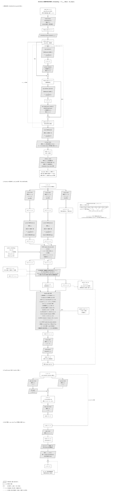

# MiniMind 完整网络结构图（Embedding → ×N_trans Block → lm_head）

下图按 `model/model_minimind.py` 的**实际网络结构**绘制, 分四节:

- **① 整体结构**（`MiniMindForCausalLM` 前向）: embedding → embedding_dropout → ×N_trans 层 Block → 最终 RMSNorm → lm_head → logits → softmax/采样
- **② Attention 内部**: 投影 / per-head RMSNorm / RoPE / KV 缓存 / 多头 GQA 分组 / 注意力核心八步
- **③ FeedForward 内部**: SwiGLU（gate/up/SiLU/⊗/down）
- **④ MoE 替换**（`use_moe=True` 时替换 ③ 的 mlp）: gate → softmax → top-1 → 专家 → Σ 累加

> 每个网络结构只画**一个浅灰平行四边形块**（模块类型、参数矩阵、计算方式展开写在块内）; 矩形 = 激活值张量; 圆 = 逐元素算子（⊕ 残差 / × 门控 / Σ 累加）; 不使用决策菱形。图中公式为 mathtext（Computer Modern）排版, 与正文 LaTeX 符号一致。

> **符号约定**: Linear 层参数矩阵统一按**线性变换语义**记 $[M, N]$（$M$ = 输入维度, $N$ = 输出维度, 即 $y = xW$）; PyTorch `nn.Linear` 存储为 [out, in], 与图中记法互为转置。Embedding 参数 $[T, D]$ 为查表矩阵（$T$ 行 × $D$ 列）, 不适用 Linear 约定。本实现 $d_q = d_k$（共用 `config.head_dim`）, 图中仍区分记法以表达通用语义。



- **静态矢量图**: [network_architecture.svg](./network_architecture.svg)（文本为字形路径, 任何查看器都不会重排换行）
- **可拖动交互版**: [network_architecture.html](./network_architecture.html)（浏览器打开; 拖动模块调整布局、连线自动跟随; 拖动**连线中点的小圆点**可手动调整该线走线通道（保持正交）, 双击圆点恢复自动走线; 公式由 KaTeX 渲染, 需联网）

重新生成（改 `scripts/gen_network_diagram.py` 中的 `NODES` / `EDGES` / `SECTIONS` 后）:

```bash
uv pip install --python .venv/bin/python matplotlib   # 首次需要
.venv/bin/python scripts/gen_network_diagram.py
```

## 图形约定

| 形状 / 线型 | 含义 |
|---|---|
| 平行四边形（浅灰底） | 网络结构块: 一个模块一个块, 块内展开写明类型、参数矩阵形状与计算 |
| 矩形（白底） | 激活值（张量）, 标注完整维度 |
| 圆 | 逐元素算子: ⊕ 残差相加 / × 门控逐元素乘 / Σ MoE 加权累加 |
| 实线箭头 | 前向数据流（恒定执行的主结构）; **箭头方向 = 张量流动方向**（上游模块的输出 → 下游模块的输入, 与代码中的数据传递一一对应） |
| 虚线箭头 | 条件路径（仅在推理/特定配置下存在）: 推理期 KV 缓存、可选输入 `attention_mask`、`×N_trans` 层循环、MoE 替换（`use_moe=True`）、generate 阶段采样; 箭头方向含义同上 |
| 虚线圆角框 | 重复单元容器: `MiniMindBlock × N_trans` |
| 虚线边框注解块 | 独立说明（不参与连线）: 多头/GQA 分组示意（查询头 ×h_q、KV 头 ×h_k 及 $h_q/h_k$ 共享关系） |

## 维度符号（括号内为默认配置值）

| 符号 | 含义 |
|---|---|
| $B$ / $L$ / $D$ | 批量大小 / **上下文长度**（当前序列总长） / 隐藏维度（$D = 768$） |
| $T$ | 词表大小（$T = 6400$, `embed_tokens` 查表行数 / one-hot 维度） |
| $h_q$ / $h_k$ | 查询头数（$h_q = 8$）/ KV 头数（$h_k = 4$, GQA; 若配置为 None 则 $h_k = h_q$） |
| $d_q$ / $d_k$ | Q 头维度 / K·V 头维度; 本实现共用 `config.head_dim`, 即 $d_q = d_k = D / h_q = 96$（点积注意力要求 $d_q = d_k$, 图中仍区分记法） |
| $C$ | **KV 缓存长度**（已缓存位置数, $0 \le C \le L$; 训练/上下文满时 $C = L$）。仅在 KV 缓存语境使用; Attention 张量形状按训练视角一律用 $L$ |
| $N_{trans}$ | Transformer 块层数 = `num_hidden_layers`（默认 8, 图 ① 中 Block 循环 $N_{trans}$ 次） |
| $I$ | FFN 中间宽度 = `intermediate_size`（默认 $\lceil D\pi/64 \rceil \cdot 64 = 2432$） |
| $E$ | MoE 专家数 = `num_experts`（默认 4）; 每 token 激活 `num_experts_per_tok` = 1 个 |
| $P_{dropout}$ | dropout 概率 = `config.dropout`（默认 0.0, 即默认前向中 dropout 均为恒等） |
| eps | RMSNorm 稳定项 = `rms_norm_eps`（默认 1e-6） |

## 关键结构要点

1. **Embedding 入口**: `input_ids` 以 one-hot 形式 $[B, L, T]$（等价于 int64 编号查表）经 `embed_tokens`（查表参数 $[T, D]$）得 $[B, L, D]$; 随后接**一次** `embedding_dropout`（代码属性名 `model.dropout`, 仅此一处模型级 dropout）。
2. **Pre-Norm Block ×N_trans**: 每层 `MiniMindBlock` = `input_layernorm → Attention → ⊕残差1 → post_attention_layernorm → FeedForward → ⊕残差2`; 两处残差提供短梯度路径, 子层只学习增量。第 $n+1$ 层的输入是第 $n$ 层 Block 的输出（残差流）。
3. **注意力（Qwen 风格）**: 输入 $x = [B, L, D]$（= `input_layernorm` 的输出, 见图② 首节点）; 投影拆头后、RoPE 前, 对 Q/K 做逐头 RMSNorm（V 不做）, 公式 $w \cdot \dfrac{x}{\sqrt{\mathrm{mean}(x^2)+\varepsilon}}$; RoPE 仅作用于 Q/K。KV 缓存按未复制头存储: 旧缓存 $[B, C, h_k, d_k]$, 更新后为 $[B, L, h_k, d_k]$（此时 $C = L$）。
4. **多头与 GQA**: $h_q = 8$ 个查询头并行独立计算 scores; $h_k = 4$ 组 KV 头, 每组被 $h_q / h_k = 2$ 个查询头共享（`repeat_kv` 复制）, 输出 concat 成 $[B, L, h_q \cdot d_k]$ 后经 `o_proj` 投回 $D$。scores 形状按训练视角记 $[B, h_q, L, L]$（$C = L$）; 增量推理时查询仅新增 $L - C$ 个位置。
5. **两条等价注意力路径**: 手动路径（缩放点积 → 因果掩码 → padding 遮罩 → softmax → attn_dropout → 加权 V）与 SDPA 融合路径（`flash=True 且 L>1 且无缓存且无 padding` 时）。attn_dropout 作用在 softmax 概率上, resid_dropout 作用在 o_proj 输出上（均仅训练且 $P_{dropout}>0$ 时生效）。
6. **FFN = SwiGLU**: $\mathrm{down}(\mathrm{SiLU}(\mathrm{gate}(x)) \cdot \mathrm{up}(x))$, 中间宽度 $I$; `use_moe=True` 时替换为 MoE（gate → softmax → top-1 → 专家 FFN → 加权累加, 训练时附加 `aux_loss` 均衡项）。
7. **输出头**: 最终 RMSNorm 后, `lm_head` 把 $D$ 投到词表得 logits $[B, L, T]$（图中参数按线性变换语义记 $[D, T]$; PyTorch 存储 $[T, D]$）; `tie_word_embeddings=True`（默认）时 **lm_head 与 embed_tokens 共享同一存储矩阵**。softmax 后: **训练** probs $[B, L, T]$ 为逐位置分布, 与错位一位的 labels $[B, L]$ 做交叉熵, 预测序列即 next_token $[B, L]$; **推理** 取尾位置 probs $[B, T]$, 经 temperature/top-k/top-p 采样出 next_token $[B, 1]$, 追加后循环生成。

## 组件与源码位置交叉索引

源码文件统一为 `model/model_minimind.py`（行号基于当前 master; 若代码变动请按符号名搜索。源码位置已加 `vscode://` 深链, 点击在 VS Code 中打开 `model/model_minimind.py` 并跳到该行起始处; 在 GitHub/浏览器中阅读时链接可能无法唤起本地 VS Code, 请按行号手动定位; 链接使用本仓库绝对路径 `/Users/hengliu/workspace/minimind`, 仓库迁移后需同步更新）:

| 图中组件 | 源码位置 | 说明 |
|---|---|---|
| 全部超参数定义 | `MiniMindConfig` [L22–84](vscode://file/Users/hengliu/workspace/minimind/model/model_minimind.py:22) | $D$/$N_{trans}$/$h_q$/$h_k$/$d$/$T$/$I$/$E$、dropout、RoPE、YaRN、MoE 配置 |
| RMSNorm 模块 | `RMSNorm` [L91–107](vscode://file/Users/hengliu/workspace/minimind/model/model_minimind.py:91) | $w \cdot \dfrac{x}{\sqrt{\mathrm{mean}(x^2)+\varepsilon}}$; float32 计算后还原 dtype |
| RoPE 频率表 | `precompute_freqs_cis` [L113–135](vscode://file/Users/hengliu/workspace/minimind/model/model_minimind.py:113) | cos/sin 表 $[\mathrm{max\_pos}, d]$; YaRN 分频插值可选 |
| RoPE 应用 | `apply_rotary_pos_emb` [L140–146](vscode://file/Users/hengliu/workspace/minimind/model/model_minimind.py:140) | $q \cdot \mathrm{cos} + \mathrm{rotate\_half}(q) \cdot \mathrm{sin}$ |
| GQA 复制 | `repeat_kv` [L151–156](vscode://file/Users/hengliu/workspace/minimind/model/model_minimind.py:151) | $[B, C, h_k, d_k] \to [B, C, h_q, d_k]$, expand+reshape; 每个 KV 头服务 $h_q/h_k$ 个查询头 |
| q/k/v/o_proj 定义 | `Attention.__init__` [L173–176](vscode://file/Users/hengliu/workspace/minimind/model/model_minimind.py:173) | 四个无 bias Linear; 图中参数记 $[D, h_q \cdot d_q]$ / $[D, h_k \cdot d_k]$ / $[h_q \cdot d_k, D]$ |
| q_norm / k_norm 定义 | `Attention.__init__` [L177–178](vscode://file/Users/hengliu/workspace/minimind/model/model_minimind.py:177) | 逐头 RMSNorm(d_q) / RMSNorm(d_k) |
| attn_dropout / resid_dropout | `Attention.__init__` [L179–180](vscode://file/Users/hengliu/workspace/minimind/model/model_minimind.py:179) | Dropout($P_{dropout}$); 前者作用 softmax 概率, 后者作用 o_proj 输出 |
| flash 标志 | `Attention.__init__` [L182](vscode://file/Users/hengliu/workspace/minimind/model/model_minimind.py:182) | SDPA 可用性 + `config.flash_attn` |
| 投影 + view 拆头 | `Attention.forward` [L191–194](vscode://file/Users/hengliu/workspace/minimind/model/model_minimind.py:191) | $[B,L,\cdot] \to [B,L,h_q,d_q]$ / $[B,L,h_k,d_k]$ |
| q_norm/k_norm 应用 | `Attention.forward` [L195](vscode://file/Users/hengliu/workspace/minimind/model/model_minimind.py:195) |  |
| RoPE 应用（Q/K） | `Attention.forward` [L196–197](vscode://file/Users/hengliu/workspace/minimind/model/model_minimind.py:196) |  |
| KV 缓存拼接 | `Attention.forward` [L198–202](vscode://file/Users/hengliu/workspace/minimind/model/model_minimind.py:198) | `torch.cat(dim=1)`: 旧缓存 $C$ + 新增 $L-C$ → 更新后 $C = L$ |
| past_kv 返回 | `Attention.forward` [L203](vscode://file/Users/hengliu/workspace/minimind/model/model_minimind.py:203) | `use_cache=True` 时返回未复制头的 K/V |
| transpose + repeat_kv | `Attention.forward` [L206](vscode://file/Users/hengliu/workspace/minimind/model/model_minimind.py:206) | 对齐为 $[B,h_q,L,d_q]$ 与 $[B,h_q,C,d_k]$ |
| SDPA 融合路径 | `Attention.forward` [L210–211](vscode://file/Users/hengliu/workspace/minimind/model/model_minimind.py:210) | 条件: flash 且 $L>1$ 且无缓存且 mask 全 1; dropout_p 传入内核 |
| 手动注意力路径 | `Attention.forward` [L215–222](vscode://file/Users/hengliu/workspace/minimind/model/model_minimind.py:215) | 缩放点积 / 因果掩码 / padding 遮罩 / softmax / attn_dropout / @xv |
| 合并头 + o_proj + resid_dropout | `Attention.forward` [L224–225](vscode://file/Users/hengliu/workspace/minimind/model/model_minimind.py:224) | 输出 concat 成 $[B, L, h_q \cdot d_k]$ |
| 返回 (output, past_kv) | `Attention.forward` [L226](vscode://file/Users/hengliu/workspace/minimind/model/model_minimind.py:226) |  |
| FeedForward（SwiGLU） | `FeedForward` [L232–246](vscode://file/Users/hengliu/workspace/minimind/model/model_minimind.py:232) | gate [L238](vscode://file/Users/hengliu/workspace/minimind/model/model_minimind.py:238) / down [L239](vscode://file/Users/hengliu/workspace/minimind/model/model_minimind.py:239) / up [L240](vscode://file/Users/hengliu/workspace/minimind/model/model_minimind.py:240) / SiLU [L241](vscode://file/Users/hengliu/workspace/minimind/model/model_minimind.py:241) / forward [L245–246](vscode://file/Users/hengliu/workspace/minimind/model/model_minimind.py:245); 参数 $[D,I]$/$[I,D]$（变换语义） |
| MoE 门控 | `MOEFeedForward` [L256](vscode://file/Users/hengliu/workspace/minimind/model/model_minimind.py:256), [L263–269](vscode://file/Users/hengliu/workspace/minimind/model/model_minimind.py:263) | gate: $D \to E$, softmax |
| MoE top-k 与直通 | `MOEFeedForward` [L270–277](vscode://file/Users/hengliu/workspace/minimind/model/model_minimind.py:270) | k=1, `norm_topk_prob` 直通估计 |
| MoE 专家执行 | `MOEFeedForward` [L278–288](vscode://file/Users/hengliu/workspace/minimind/model/model_minimind.py:278) | 仅被选中 token 过对应专家, `index_add_` 累加 |
| MoE aux_loss | `MOEFeedForward` [L289–296](vscode://file/Users/hengliu/workspace/minimind/model/model_minimind.py:289) | 负载均衡辅助损失（训练时） |
| Block 组装 | `MiniMindBlock.__init__` [L304–309](vscode://file/Users/hengliu/workspace/minimind/model/model_minimind.py:304) | attn [L306](vscode://file/Users/hengliu/workspace/minimind/model/model_minimind.py:306) / input_layernorm [L307](vscode://file/Users/hengliu/workspace/minimind/model/model_minimind.py:307) / post_attention_layernorm [L308](vscode://file/Users/hengliu/workspace/minimind/model/model_minimind.py:308) / mlp [L309](vscode://file/Users/hengliu/workspace/minimind/model/model_minimind.py:309) |
| 残差 1 | `MiniMindBlock.forward` [L314](vscode://file/Users/hengliu/workspace/minimind/model/model_minimind.py:314), [L321](vscode://file/Users/hengliu/workspace/minimind/model/model_minimind.py:321) | `residual = h; h += residual`（注意力后, 残差源 = LN 之前的 h, Pre-Norm） |
| 残差 2 | `MiniMindBlock.forward` [L322](vscode://file/Users/hengliu/workspace/minimind/model/model_minimind.py:322) | `h = h + mlp(...)`（FFN 后） |
| embed_tokens / embedding_dropout / 层列表 / 最终 norm | `MiniMindModel.__init__` [L334–337](vscode://file/Users/hengliu/workspace/minimind/model/model_minimind.py:334) | Embedding [L334](vscode://file/Users/hengliu/workspace/minimind/model/model_minimind.py:334) / embedding_dropout（`model.dropout`）[L335](vscode://file/Users/hengliu/workspace/minimind/model/model_minimind.py:335) / layers [L336](vscode://file/Users/hengliu/workspace/minimind/model/model_minimind.py:336) / norm [L337](vscode://file/Users/hengliu/workspace/minimind/model/model_minimind.py:337) |
| embedding + embedding_dropout 应用 | `MiniMindModel.forward` [L351](vscode://file/Users/hengliu/workspace/minimind/model/model_minimind.py:351) | `dropout(embed_tokens(input_ids))`, 仅一次 |
| 位置切片 | `MiniMindModel.forward` [L356–359](vscode://file/Users/hengliu/workspace/minimind/model/model_minimind.py:356) | 按 `start_pos` 切 cos/sin（含 meta-device 重算） |
| 层循环 ×N_trans | `MiniMindModel.forward` [L361–369](vscode://file/Users/hengliu/workspace/minimind/model/model_minimind.py:361) | 逐层调 Block, 收集 presents |
| 最终 norm / aux 汇总 | `MiniMindModel.forward` [L370–371](vscode://file/Users/hengliu/workspace/minimind/model/model_minimind.py:370) |  |
| lm_head | `MiniMindForCausalLM.__init__` [L385–386](vscode://file/Users/hengliu/workspace/minimind/model/model_minimind.py:385) | Linear $D \to T$（变换语义 $[D, T]$; 存储 $[T, D]$ 与 embed_tokens 共享, [L378](vscode://file/Users/hengliu/workspace/minimind/model/model_minimind.py:378) 声明） |
| logits / 交叉熵 | `MiniMindForCausalLM.forward` [L392–405](vscode://file/Users/hengliu/workspace/minimind/model/model_minimind.py:392) | logits [L396](vscode://file/Users/hengliu/workspace/minimind/model/model_minimind.py:396); 训练损失（错位一位, -100 忽略）[L398–404](vscode://file/Users/hengliu/workspace/minimind/model/model_minimind.py:398) |
| generate 采样 | `MiniMindForCausalLM.generate` [L413–455](vscode://file/Users/hengliu/workspace/minimind/model/model_minimind.py:413) | temperature / 重复惩罚 / top-k / top-p / 多项式采样 [L428–446](vscode://file/Users/hengliu/workspace/minimind/model/model_minimind.py:428) |

仓库内其他相关入口: `eval_llm.py`（CLI 推理）、`scripts/convert_model.py`（权重转 Transformers 格式）、`scripts/web_demo.py`（StreamLit 演示）、`trainer/train_pretrain.py` 等（各阶段训练脚本）。

## 数据流速记

1. `input_ids` $[B,L,T]$ → **embed** → `embedding_dropout`（一次）→ $[B,L,D]$
2. **×N_trans 层**: LN → **Attention**（投影→逐头RMSNorm→RoPE→[KV缓存]→GQA→核心八步）→ ⊕ → LN → **FFN(SwiGLU/MoE)** → ⊕
3. 最终 RMSNorm → **lm_head**（与 embed 共享权重）→ logits $[B,L,T]$
4. 输出: 训练 probs $[B,L,T]$ vs labels $[B,L]$ 交叉熵; generate: 尾位置 probs $[B, T]$ → temperature/top-k/top-p 采样 → next_token $[B, 1]$, 追加到 input_ids 循环生成, 直至 EOS
